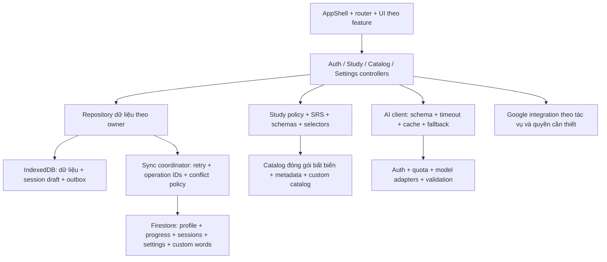

# Kế hoạch chỉnh sửa và nâng cấp ENG_MASTER

Cập nhật giọng đọc 16/11/2026: bộ từ 1.575 mục chuyển sang cùng audio Michael/Kokoro, hội thoại đóng gói cố định theo nhân vật; dự phòng giọng hệ thống chỉ cho nội dung chưa có audio và có nhãn rõ. Bốn mươi pack thêm 29 MB offline; không sửa catalog hoặc audio đề thi. Chi tiết và giới hạn: docs/CONSISTENT_VOICE.md. Kết quả kiểm tra/phát hành: output/verification/voice-release.json.

Cập nhật 16/11/2026: sửa bố cục mặt sau thẻ học để vùng nghĩa/ví dụ cuộn độc lập, nút AI và hàng đánh giá không che nhau. Kiểm tra năm kích thước màn hình, nội dung dài và lưu bằng bàn phím đạt. Người dùng yêu cầu commit/push/phát hành; kết quả lần phát hành ghi tại output/verification/review-layout-release.json. Bằng chứng UI: output/verification/review-layout-browser.log và review-layout-long-browser.log. Trạng thái learning.8 dưới đây là hồ sơ phát hành trước.

Ngày cập nhật: 16/10/2026. Trạng thái: **learning.8 đã phát hành và nghiệm thu sáu nhóm; mức thấp nhất 95,70%, mọi gate bắt buộc đạt. Ngân hàng 311 câu, đề 200 câu và audio đóng gói đã lên Production**. Google OAuth và Calendar/Tasks/Drive đã nghiệm thu ở đợt trước.
Phạm vi đã xác nhận: độ ổn định/lưu dữ liệu, trải nghiệm/giao diện, tính năng học mới và AI.
Cơ sở kỹ thuật: [báo cáo rà soát](docs/CODEBASE_AUDIT.md).

Bằng chứng mốc trước — production learning.7 và local 277 câu: Local có thêm [gói nghe](docs/LISTENING_PILOT.md), 93 câu bổ sung và [đề 200 câu](docs/FULL_EXAM.md), tổng ngân hàng 277. Codex chịu trách nhiệm rà soát theo chỉ định người dùng; đã kiểm tra chéo mù đáp án bằng Gemini theo phép người dùng và chốt rà soát đáp án/văn bản/ảnh cho 277 câu (docs/CONTENT_REVIEW.md). Chưa phát hành hoặc nghiệm thu audio/chuẩn hóa đề đầy đủ. Tại mốc trước này, 95% toàn hệ thống còn mở; kết quả learning.8 hiện tại nằm trong docs/ACCEPTANCE_95.md.

Hồ sơ mới: [ACCEPTANCE_95.md](docs/ACCEPTANCE_95.md), output/verification/system-acceptance-final.json. Không suy phần trăm từ số unit tests; giữ riêng 96,5% đầu ra ứng dụng và 95,70% đầu ra model sinh. Avatar/native TTL/billing giữ quyết định trì hoãn.

## 1. Mục tiêu và nguyên tắc

**Mốc hoàn thành bắt buộc: ≥95% toàn hệ thống học tập**, tái xác nhận 16/10/2026. Áp dụng riêng cho sáu nhóm nghiệm thu, không lấy trung bình để bù nhóm yếu; điều kiện cốt lõi và lỗi nghiêm trọng phải được xử lý hoàn toàn. Không đóng mục tiêu này khi chỉ hoàn thành gói thử hoặc phát hành trung gian. Tiêu chí, bằng chứng và thứ tự công việc: [QUALITY_TARGET_95.md](docs/QUALITY_TARGET_95.md#mốc-nghiệm-thu-bắt-buộc).

Nâng cấp ứng dụng hiện có thành hệ thống học đáng tin cậy trên điện thoại và máy tính: học offline không mất tiến độ, đồng bộ có trạng thái thực, phiên học có thể tiếp tục, thống kê dựa trên dữ liệu thật và AI hỗ trợ các nhiệm vụ học cụ thể.

- Bảo toàn **1.575 mục đóng gói**, ID, nguồn PDF, nội dung đã chốt và tiến độ đã lưu. Metadata chủ đề/deck/độ khó mới nằm riêng; không tự sửa nội dung từ vựng trong đợt nâng cấp hệ thống.
- Giữ React, TypeScript, Firebase và API handler dùng chung. Thay đổi từng luồng qua các đợt nhỏ có kiểm tra, không thay toàn bộ hệ thống trong một lần.
- Mọi thao tác học cần được lưu bền vững hoặc có lỗi khôi phục rõ ràng trước khi coi là hoàn tất. Badge đồng bộ phản ánh pending/error/confirmed, tách khỏi trạng thái có mạng.
- Thay đổi schema phải có version, migration đọc dữ liệu cũ, kiểm tra round-trip và đường quay lại.
- Tách chức năng học cốt lõi khỏi sự khả dụng của AI và Google Workspace. AI sinh nội dung riêng, không ghi đè bộ từ đã chốt.
- Sau mỗi đợt, cập nhật trạng thái hạng mục và bằng chứng nghiệm thu trong tài liệu này.

## 2. Kiến trúc đích



Cấu trúc dự kiến, triển khai theo từng đợt:

```text
src/app/                 AppShell, route, providers, ErrorBoundary
src/features/auth/       đăng nhập, guest, chuyển/merge tài khoản
src/features/study/      session controller, thẻ, quiz, practice, draft
src/features/library/    tìm kiếm, filter, favorites, custom words, decks
src/features/stats/      selectors và biểu đồ dựa trên study events
src/features/settings/   profile, preferences, backup/restore
src/domain/              schemas, SRS, study policy, catalog interfaces
src/repositories/        local/cloud adapters, migrations, sync
src/services/            AI, OAuth Workspace, speech, reminders
src/data/                catalog đóng gói và metadata học
src/server/              shared HTTP, auth/quota, AI adapters
```

Chỉ thêm các thư mục khi chuyển logic tương ứng. Context + reducer/hooks là điểm khởi đầu cho state; chọn thêm thư viện nếu phạm vi selector/subscription thực sự cần. Schema runtime cần dùng chung cho local/import/cloud/AI; có thể dùng validator nhỏ hoặc thư viện schema sau khi thử trên một luồng.

## 3. Dữ liệu đích và migration

| Dữ liệu | Thiết kế dự kiến | Tương thích cần giữ |
|---|---|---|
| Catalog | Catalog bundled bất biến; custom words theo owner; selector `allWords/wordById` có version | ID cũ vẫn trỏ đúng từ; tổng bundled luôn 1.575 |
| Progress | Trạng thái SRS + revision/updatedAt; schema kiểm tra phạm vi và ngày | Đọc được easiness, interval, repetitions, ISO nextReviewDate và wrongCount cũ |
| Study event | eventId/operationId, sessionId, wordId, mode, kết quả/quality, occurredAt, timezone, duration; snapshot SRS cần thiết cho thống kê | Không dựng lịch sử giả từ progress cũ |
| Session | ID ổn định, mode, word queue, cursor, completed/partial, thời gian và kết quả | Import history cũ như dữ liệu legacy; giữ loại/score/details |
| Daily activity | Unique wordIds, số lượt trả lời, đúng/sai, thời lượng; tổng hợp có thể đối chiếu events | Tiếp tục đọc dateKey/wordIds cũ; không tính lại cùng operation hai lần |
| Preferences | Scope rõ: thiết bị hoặc tài khoản; favorites/decks và custom words theo owner | Migration các khóa localStorage hiện tại không âm thầm gán cho tài khoản bất kỳ |
| Backup v3 | catalog/schema version + profile + progress + custom words + favorites + settings + daily activity + sessions; metadata export | V2 và legacy vẫn nhập được; thiếu lịch sử thì hiển thị thiếu, không xóa/sáng tạo lịch sử ngoài chủ ý |
| Restore job | Validate/preview, snapshot trước restore, job ID + journal/batch state, bước chuyển dataset active | Dữ liệu cũ có thể phục hồi nếu mạng/lưu lỗi |

Thứ tự migration: chụp snapshot cũ → kiểm tra schema → ghi dữ liệu mới trong namespace/version riêng → kiểm tra số lượng/ID/checksum → chuyển active version → giữ bản cũ trong thời gian hỗ trợ rollback. Khi đăng nhập từ guest, hiện preview số mục và xung đột để người dùng chọn merge; không chuyển guest tự động khi Cloud mất mạng.

Đồng bộ cần phân biệt hai việc: operation ID giúp tránh áp dụng lặp cùng thao tác, nhưng không tự giải quyết hai thao tác khác nhau đồng thời trên cùng từ. Chính sách xung đột phải được ghi trong ADR và kiểm thử với hai thiết bị. Định hướng: ghi study events bất biến, xử lý thứ tự/version khi cập nhật progress; không chọn bản có interval lớn nhất một cách tùy tiện.

## 4. Các đợt thực hiện

### Đợt 1 — Sửa lỗi lưu và sao lưu đang có

Ưu tiên P0; xử lý F01–F04 cùng phần chống thao tác lặp F07. Đã thực hiện và kiểm tra; xem [bằng chứng đợt 1](docs/PHASE1_VERIFICATION.md).

- [x] U01: Tạo session log không chứa undefined; schema input và serializer dùng chung. Regression test Cloud history của review/practice.
- [x] U02: Backup nhận catalog hiện hành thay vì tập ID cố định lúc import; bổ sung định nghĩa custom words qua version mới. Nhập được backup của từ thêm trong phiên và trên trình duyệt mới.
- [x] U03: JSON/CSV đi chung validator, giới hạn file/row, preview số từ, lỗi theo dòng và xác nhận merge/replace. File rỗng/hỏng không được kích hoạt restore; phân biệt lỗi file với lỗi Cloud.
- [x] U04: Restore/reset stage generation mới rồi atomic activation, bảo vệ outbox cũ, phục hồi journal và rollback qua generation mới; Emulator/browser production đã đạt.
- [x] U05: Khóa thao tác chấm thẻ khi commit/chuyển thẻ; callback Promise được await; operation/session IDs ổn định. Cùng thao tác chỉ ghi một lần.
- [x] U06: Thông báo profile/goal/avatar đợi kết quả lưu; lỗi có trạng thái phục hồi nhất quán.

File trọng tâm: `src/App.tsx`, `src/lib/backup.ts`, `persistence.ts`, `productPreferences.ts`, `components/SettingsView.tsx`, `ReviewSession.tsx`, `PracticeSession.tsx`.

Nghiệm thu: round-trip bundled + custom trên local sạch; invalid CSV giữ nguyên dữ liệu; thiếu trường optional vẫn lưu history; nhấn đôi chỉ ghi một event; restore bị ngắt sau batch có thể phục hồi dữ liệu trước đó. Có test Emulator cho write/history và kiểm tra browser các đường người dùng.

### Đợt 2 — Tách trách nhiệm và thống nhất schema

Phụ thuộc Đợt 1; giải quyết F12/F15/F20 để các nâng cấp tiếp theo không nhân bản logic.

- [x] U07: Tách AppShell/navigation, auth controller, profile/progress repository và Google services khỏi `App.tsx`.
- [x] U08: Tách bundled/custom catalog, bỏ push/splice toàn cục; selector có wordById và phản ứng khi thêm/xóa. Xóa custom word có chính sách cleanup/archive cho progress/favorites/events.
- [x] U09: Tách shared flashcard/rating/speech; xóa imports/helpers không dùng và các bản sao reminder.
- [x] U10: Schema runtime cho progress/profile/session/preferences/backup; cùng phạm vi hợp lệ ở UI/import/repository/rules.
- [x] U11: Đồng bộ blueprint/types/rules/docs; thêm lint thực và tăng strict TypeScript theo module, ghi lại các ngoại lệ tạm thời.
- [x] U12: Thêm routing URL/history, Error Boundary và loading/error state cho lazy screen.

Nghiệm thu: màn hình cũ giữ các luồng đã chạy, Back/refresh đúng route; không có shared catalog mutation; bộ schema/rules không lệch giới hạn; gates và regression flows đạt. Mục đích là giảm coupling, không lấy số dòng làm tiêu chí thành công duy nhất.

### Đợt 3 — Lưu local bền vững và đồng bộ tài khoản

Phụ thuộc schema/repository của Đợt 2; xử lý F05/F06/F12.

- [x] U13: Local repository IndexedDB có migration từ localStorage và owner namespace guest/user; xử lý quota/storage errors.
- [x] U14: Local commit lưu event/progress/outbox trong transaction trước khi UI tiến tiếp; sync coordinator theo operation ID, retry có backoff và pending/failed/confirmed.
- [x] U15: Cloud cập nhật progress với version/conflict policy; bỏ cập nhật totalWordsLearned cạnh tranh từ nhiều client, dùng derived selector hoặc tổng hợp có đối chiếu.
- [x] U16: Subscribe dữ liệu Cloud khi đăng nhập, cleanup khi logout/đổi tài khoản; giữ local của tài khoản khi mất mạng. Chọn một nguồn điều phối retry, tránh hai outbox độc lập áp dụng trùng khi cấu hình Firestore persistent cache.
- [x] U17: Luồng guest → Google có preview/merge; favorites/custom words/decks/settings theo owner được đồng bộ và backup.

Nghiệm thu: học mất mạng → reload → có tiến độ và thao tác pending → kết nối lại đồng bộ một lần; hai tab và hai thiết bị không làm giảm/sai tiến độ ngoài policy; đổi tài khoản không lẫn từ cá nhân; migration thất bại vẫn đọc được bản cũ. Kiểm tra rules ownership bằng Emulator, sau đó xác nhận bằng tài khoản staging.

### Đợt 4 — Engine phiên học và chính sách SRS

Phụ thuộc Đợt 2–3; xử lý F07–F09/F11 và chuẩn bị dữ liệu cho thống kê.

- [x] U18: Engine chung quản lý queue/cursor/draft/answer/rating/completion; lưu phiên dở, tiếp tục hoặc kết thúc sớm với số từ thực đã làm.
- [x] U19: SM-2 nhận `now/clock` rõ ràng để kiểm thử ngày, múi giờ, lapse và interval; giữ baseline cũ, không tự migrate sang thuật toán khác.
- [x] U20: Policy rating 1/3/4/5 thống nhất Review/Practice; bỏ thay quality ngầm theo độ khó hoặc giải thích thành policy có test. Quiz mặc định ghi kết quả/lỗi và evidence học, tách cập nhật lịch SRS tự đánh giá cho đến khi có chính sách được xác nhận.
- [x] U21: Planner chung: đến hạn/overdue trước, sau đó từ yếu và quota từ mới; từ tương lai không gắn nhãn đến hạn. Dashboard hiển thị đúng queue mà người học sẽ bắt đầu.
- [x] U22: Cỡ phiên dùng chung settings; selection/shuffle có seed trong test, distractors không trùng/không cùng nghĩa gây nhiều đáp án đúng; chuẩn hóa đáp án gõ cho khoảng trắng/apostrophe/hyphen.

Nghiệm thu: cùng rating và state cho cùng kết quả ở Review/Practice; hoàn thành/hủy/tiếp tục có số đếm đúng; đáp án replay không ghi lặp; due/future/new hiển thị đúng vào ranh giới ngày; cùng từ học hai lần không bị đếm hai từ mới trong ngày.

### Đợt 5 — Trải nghiệm và giao diện toàn hệ thống

Phụ thuộc AppShell/planner/session state; cải tiến theo luồng người học, áp dụng cho tất cả màn hình.

- [x] U23: Dashboard tập trung vào hành động học tiếp theo, mục tiêu ngày, pending sync, phiên dở và từ yếu. Tách “đã bắt đầu”, “đã thuộc”, “thành thạo” bằng nhãn/selector chung.
- [x] U24: Thư viện có search/filter giữ trên URL, deck/topic cá nhân, thêm/sửa từ, feedback validation và xử lý trùng; học từ danh sách chọn/favorites.
- [x] U25: Màn học dùng card/rating thống nhất, keyboard shortcuts có hướng dẫn, audio tốc độ/giọng, preview lịch lần ôn tiếp theo; xác nhận khi rời phiên còn dở.
- [x] U26: Chuẩn hóa token màu/spacing/type và copy tiếng Việt; giữ tinh thần dark UI hiện tại, cân đối mobile safe area và thao tác một tay.
- [x] U27: Accessibility: label cho form, focus/keyboard, hidden card không còn nhận focus, reduced motion, tương phản và trạng thái lỗi/loading rõ. Modal quản lý focus không reset khi callback thay đổi mỗi render.
- [x] U28: Settings phân biệt tùy chọn thiết bị/tài khoản, tình trạng backup/sync và giới hạn nhắc học; không báo lịch chạy nền đã sẵn sàng nếu mới dùng timer khi trang mở.

Nghiệm thu: browser QA tối thiểu 360/390/768/1280 px; không tràn ngang; thao tác học/backup khả dụng bằng keyboard; đổi route/refresh giữ filter/draft; thiết kế có ảnh kiểm tra thực tế và tất cả trạng thái rỗng/lỗi/mất mạng.

### Đợt 6 — Thống kê dựa trên lịch sử thật

Phụ thuộc events của Đợt 4; xử lý F10/F11.

- [x] U29: Lưu sessions/events tách khỏi profile, query theo khoảng ngày; profile chỉ giữ tóm tắt tương thích.
- [x] U30: Thống kê 7/30/90 ngày từ events: lượt học, từ duy nhất, đúng/sai quiz, thời lượng hoạt động, due backlog và phân bố mastery. Đồng bộ nhãn ngưỡng ≥3/≥7.
- [x] U31: EF chart dùng snapshot events hoặc daily aggregates thật; trục phù hợp dữ liệu, không đặt điểm khởi đầu giả. Dữ liệu legacy thiếu chi tiết được đánh dấu thiếu lịch sử.
- [x] U32: Topic/deck breakdown, từ khó lặp và heatmap từ dailyActivity, không suy diễn heatmap chỉ từ 50 history gần nhất. Tránh phép tính running average O(n²).

Nghiệm thu: bộ fixtures có kết quả số đếm/tỷ lệ biết trước; ngày Việt Nam và timezone khác đúng; sessions partial đúng; chênh lệch Dashboard/Stats bằng 0 theo cùng selector; thời gian idle/background không tính như học liên tục.

### Đợt 7 — Tính năng học mở rộng và AI có kiểm soát chất lượng

Phụ thuộc schema, engine, catalog và events; giải quyết F13/F17. Chia nhỏ để kiểm tra từng loại bài.

- [x] U33: Cloze từ ví dụ song ngữ đã chốt, học collocation/cụm từ và quiz theo deck; kiểm tra câu có đúng một mục tiêu/đáp án.
- [x] U34: Nghe → gõ/ghép nghĩa, dùng speech service chung hoặc audio có cache; xử lý thiếu giọng, tốc độ và phát lại. Chưa coi Web Speech là đánh giá phát âm.
- [x] U35: AI giải thích theo trình độ, nghĩa được chọn và ngôn ngữ Việt; cache theo word ID + content/prompt/model version; output gắn nguồn sinh và không ghi vào catalog canonical.
- [x] U36: AI quiz gửi ID thật; schema request/response dùng chung; kiểm tra coverage, enum type, đáp án nằm trong MCQ, distractors duy nhất, độ dài, ngôn ngữ và câu điền. Match bằng ID, không bằng option text.
- [x] U37: AI sửa lỗi dựa trên attempt đã lưu, có ví dụ đúng và bài ôn tiếp; người học chủ động yêu cầu, guest được dùng feedback offline. Nội dung sai schema/ngữ cảnh bị loại và fallback rõ ràng.
- [x] U38: Timeout/cancel, retry theo lỗi, quota theo user/ngày và ngân sách dự kiến; lưu token/latency/error category ở server, Retention cho rate-limit docs bằng cleanup backend khi native TTL không khả dụng. Kiểm tra model thật trong staging, khai báo model vars trong `.env.example`.
- [ ] U39 — Tạm hoãn theo yêu cầu ngày 15/10/2026: Avatar AI giữ tắt; chỉ xem lại object storage/policy/rules khi người dùng thay đổi ưu tiên.

Nghiệm thu: response hỏng/ID lạ/đáp án sai không thành câu chấm điểm; AI lỗi vẫn hoàn thành quiz offline; cancel/timeout không treo UI; thử bộ câu đại diện và review nội dung học. Tính năng phát âm có chấm điểm và mô phỏng điểm TOEIC chỉ lên đợt riêng khi có thiết kế đánh giá/benchmark phù hợp.

### Đợt 8 — Offline PWA, hiệu năng và tích hợp Google

PWA và performance có thể bắt đầu sau Đợt 2; kiểm thử đầy đủ cần Đợt 3–4. Google tách riêng được để không cản phần học.

- [x] U40: Sinh precache manifest từ production build, bao gồm screens/catalog/CSS cần offline; revision/hash đúng. Navigation fallback chỉ dành cho HTML; loại API khỏi cache, không cache response lỗi, cleanup chỉ cache của ứng dụng.
- [x] U41: Update PWA có thông báo và checkpoint phiên học trước reload; manifest/icons hoàn chỉnh; xử lý lỗi đăng ký worker. Reload offline và mở screen chưa từng mở phải hoạt động sau khi tải offline pack xong.
- [x] U42: Sửa chunk graph để charts chỉ tải khi vào Stats; xem xét Firebase client khởi tạo theo nhu cầu guest/login. Đo cold/warm route, không đánh giá hiệu năng chỉ qua ngưỡng chunk 500 kB.
- [x] U43: Search/index/selectors được memoize khi có lợi; danh sách nhiều từ dùng windowing khi đo thực sự cần. Font self-host/cache để trải nghiệm offline nhất quán.
- [ ] U44: OAuth chỉ xin scope cần cho tác vụ, reuse token trong cùng action, retry một lần khi token hết hạn; idempotency cho Tasks/Calendar/Drive. Cho chọn giờ/lịch thay vì cố định sau một giờ.
- [x] U45: Reminder service khởi tạo cùng app và mô tả đúng giới hạn. Nếu yêu cầu nhắc khi đóng app, thiết kế push/backend riêng, kiểm tra hỗ trợ nền tảng và chi phí trước triển khai.

Nghiệm thu: test production worker có network offline, missing chunk, release update và resume draft; charts không nằm trong dependency/preload của route học đầu. Mục tiêu build ban đầu: giảm tài nguyên HTML tham chiếu từ 509.055 byte gzip xuống dưới 420.000 byte, cần đo lại sau thay đổi và không hy sinh nội dung cần offline. Google action chạy staging với số popup hợp lý và không tạo bản ghi trùng khi retry.

### Đợt 9 — Kiểm thử, quan sát và phát hành

Chạy xuyên suốt từ Đợt 1; trở thành cổng cuối trước đưa bản nâng cấp lên production.

- [x] U46: CI Node 22, lockfile install, typecheck/lint/unit/vocabulary/build và kiểm tra dependency có phân loại tác động. Ghi actual versions; không chạy auto-upgrade hàng loạt.
- [x] U47: Emulator tests ownership, bounds, invalid IDs/data, custom words/events/settings; test rate-limit transaction thực và Express/Vercel HTTP parity.
- [x] U48: E2E được version hóa: guest reload, complete/partial review, quiz, practice, custom backup, invalid CSV, restore failure, offline retry, account switch và PWA update.
- [x] U49: Error reporting/log có request/session/operation IDs, sync failure metrics, AI latency/quota và release version; không đưa raw token/credentials vào logs.
- [ ] U50: Runbook env/domain/OAuth/rules/indexes/TTL/storage khi có sử dụng; staging acceptance, feature flags, canary và rollback frontend/schema. `firebase.json` hiện tại không được coi là cấu hình Hosting hoàn chỉnh.

Nghiệm thu: release gates Node 22 đạt, dữ liệu snapshot/migration có thử phục hồi, các luồng staging Google/AI/Firestore thực có bằng chứng, preview cùng production handler hoạt động, rollback đã thử trên dữ liệu staging.

## 5. Thứ tự ưu tiên và các mốc bàn giao

| Mốc | Phạm vi | Điều kiện bàn giao |
|---|---|---|
| M1 — Sửa lỗi hiện hữu | U01–U06 | Không còn hai lỗi đã tái hiện; JSON/CSV/restore có đường bảo toàn dữ liệu |
| M2 — Nền tảng dễ mở rộng | U07–U17 | Schema/repository/owner scope hoàn chỉnh; offline retry và account merge qua kiểm tra |
| M3 — Học nhất quán | U18–U28 | Engine phiên học, planner, UX học và library thống nhất; draft hoạt động |
| M4 — Phân tích và nội dung học | U29–U39 | Thống kê từ events thật; các loại bài mới/AI qua kiểm tra chất lượng |
| M5 — Bản phát hành | U40–U50, trong đó QA/CI làm từ đầu | Offline production + tối ưu + staging + rollback có bằng chứng |

Không gom toàn bộ 50 hạng mục vào một PR. Chia theo luồng end-to-end: mỗi hạng mục có schema/UI/persistence/test đủ để dùng và review được. Thời gian/ngân sách chốt sau M1 khi biết môi trường staging và khối lượng migration; thứ tự trên là cam kết kỹ thuật về phụ thuộc, không phải ước lượng lịch giao.

## 6. Ma trận nghiệm thu xuyên suốt

| Tình huống | Kết quả phải đạt |
|---|---|
| Guest học rồi reload | Progress, draft và dữ liệu cá nhân còn nguyên |
| Cloud không ghi được | Thao tác được giữ local/pending hoặc dừng với lỗi khôi phục; không báo đã đồng bộ |
| Nhấn chấm thẻ hai lần | Một thao tác/event, cursor không nhảy bỏ thẻ |
| Hai thiết bị cập nhật cùng từ | Xử lý theo conflict policy, có khả năng đối chiếu event/version |
| Backup trên trình duyệt sạch | Khôi phục custom words + progress + favorites/settings và dữ liệu trong scope backup |
| CSV/JSON sai | Không đổi dữ liệu hiện tại, chỉ rõ lỗi |
| Restore bị ngắt | Resume/rollback có kiểm tra số lượng và ID |
| Chuyển guest/tài khoản | Không mất hoặc lẫn dữ liệu; merge có preview |
| Đi qua nửa đêm/đổi timezone | Due queue, activity và streak có quy tắc nhất quán |
| AI trả sai schema/ID/answer | Reject/fallback; không lưu câu sai làm căn cứ tiến độ |
| Mở screen lần đầu khi offline | Tải từ offline pack, không nhận HTML thay JS |
| Cập nhật phiên bản khi đang học | Checkpoint/draft còn sau update; old/new assets không trộn |
| Bundled vocabulary sau nâng cấp | Đúng 1.575 mục, ID và nội dung đã chốt không đổi |

## 7. Trạng thái hiện tại

Learning.7 đã phát hành: deployment dpl_EXuHgSHHuJrWgAA4F8nZmdCnaXDR, khảo sát nền tảng 20 câu/4 bước và sửa chất lượng/provenance AI; 184 unit, 4 native API imports, 13 nhóm UI local + production, 12 ca API candidate cuối đạt. Pilot 45 mục có nguồn hỗn hợp đã đọc riêng; không chứng minh 95% toàn hệ thống. Part 1/3/4, đề tích hợp 200 câu và nghiệm thu nội dung đầy đủ còn thiếu. Xem [mục tiêu 95%](docs/QUALITY_TARGET_95.md) và output/verification/quality95-release.json. Giữ model/catalog/rules/billing/flags tạm hoãn.

Hồ sơ các bản trước:

Bản trước `2026.10.15-learning.6` đã promote thành deployment `dpl_52TyUZfxB5cxsMrsQTDFSpNHNSSE` và đạt kiểm tra production. Xem [LEARNING_CONTENT_UPGRADE.md](docs/LEARNING_CONTENT_UPGRADE.md) cho 166 câu, ngữ pháp, Part 6/7, backup v4 và giới hạn; backlog tiếp theo ở [NEXT_UPGRADE_PLAN.md](docs/NEXT_UPGRADE_PLAN.md). Bằng chứng learning.1 và upgrade.4 giữ nguyên trong tài liệu từng đợt.

AI học tập learning.6: JSON cho giải thích/review, lookup dữ liệu đã rà soát và bốn tác vụ hỏi tiếp (đơn giản hơn/ví dụ/so sánh/kiểm tra nhanh); review dùng câu gốc và chia lượt 5 lỗi. 165 unit, 4 native imports, 12 ca AI/API thật local + candidate, 10 nhóm UI local + production và public scan đạt; QA đã dọn. Nguồn gốc và AI bổ sung có nhãn riêng; kiểm tra schema không chứng minh mọi lời giải/MCQ đúng ngữ nghĩa. Các mẫu còn hạn chế được ghi rõ ở [AI_LEARNING_MODULE.md](docs/AI_LEARNING_MODULE.md). Không đổi model, rules, catalog hoặc billing.

Hộp thoại AI Thư viện learning.5: bỏ lời giải inline trong thẻ; dùng chung dialog với màn học, giữ tiêu đề/nút đóng khi cuộn, lỗi/thử lại, cache và hủy request. 146 unit (bảy ca mới), typecheck/lint/build/catalog, bốn native API imports và bảy nhóm browser local + production đạt; QA đã dọn. Xem [LIBRARY_AI_DIALOG.md](docs/LIBRARY_AI_DIALOG.md).

Giao diện AI learning.4: Markdown dùng chung, khối màu có nhãn, so sánh đúng/sai desktop/mobile và lỗi gọi AI hiển thị riêng. 139 unit (sáu ca mới), typecheck/lint/build/catalog và bốn native API imports đạt; năm nhóm UI local và production đạt, QA đã dọn. Không thay prompt/model/schema/rules. Xem [AI_RESPONSE_LAYOUT.md](docs/AI_RESPONSE_LAYOUT.md).

Bản vá PWA learning.3: 133 unit (10 ca mới), typecheck/lint/build/catalog và 4 native API imports đạt. Bốn nhóm cập nhật local và fixture banner stale trên production đạt; giữ đúng một lần chấm, thẻ đang học và offline reload. Tab còn mã cũ cần tải lại một lần; phép thử chuyển tab cũ bị timeout không được tính đạt. Xem [PWA_UPDATE_FIX.md](docs/PWA_UPDATE_FIX.md). Không thay backend/rules/billing.

Bằng chứng lịch sử — gates learning.2: 123 unit/UI/repository/HTTP tests, 14 Emulator tests, 4 native API imports; typecheck/lint/catalog/build đạt và audit 0 vulnerabilities. Production: 9 nhóm nội dung + 8 hồi quy; Cloud local 4 nhóm, client SDK thật 6 nhóm và candidate AI/API 6 ca; QA đã dọn. Catalog 1.575 từ và ngân hàng gốc 60 câu có hash không đổi. Production initial referenced gzip 394.866 byte, offline pack 42 assets; public scan không phát hiện server secrets. Báo cáo: output/verification/learning2-release.json.

Quyết định ngày 15/10/2026: ưu tiên tính năng học tập theo backlog L01–L04 trong kế hoạch tiếp theo. Avatar AI và native TTL tạm hoãn, giữ tắt; billing giữ nguyên. Hai hạng mục này không chặn phát triển/phát hành tính năng học tập.

Bằng chứng lịch sử — gates learning.1: Node 22, typecheck/lint/catalog/build đạt; 106 unit/UI/repository/HTTP tests, 13 Emulator tests, 4 native Node API imports; npm audit 0 vulnerabilities. Tám nhóm browser học tập production đạt, gồm retry đúng ID câu gốc, Học hôm nay/resume và audio offline lặp ba lần; 6 ca API candidate đạt và QA đã dọn. Catalog vẫn 1.575 mục, ba hash baseline không đổi; production initial referenced gzip 393.556 byte, dưới 420.000; offline pack 42 assets gồm worker PDF. Năm ca dataset và Google OAuth/Workspace thật giữ bằng chứng ở đợt upgrade.4.

Các đợt nền tảng đã bổ sung sổ lỗi sai từ câu trả lời thực, lộ trình ngày thi, 6 bài ngữ cảnh và 60 câu luyện ban đầu, nghe hội thoại qua local voice, Part 2/Part 5 có draft/timer/kết quả riêng, PDF/CSV import preview vào thư viện cá nhân, backup 20 MB, lịch sử export phân trang và dọn generations cũ có xác nhận. Dữ liệu học đã nộp thuộc owner và có backup; không thay catalog đã duyệt. Learning.1 nối sổ lỗi Part 2/5/ngữ cảnh với từ vựng, thêm làm lại đúng câu đã sai, Học hôm nay có resume, lọc/trộn câu, nghe từng câu/chọn giọng/lặp/tô sáng và thống kê chủ điểm. Bản nháp Học hôm nay/bài luyện chỉ lưu trên thiết bị, không nằm trong backup thông thường; vô hiệu hóa khi thay dataset và giữ trong archive trước adopt.

Google OAuth tài khoản người dùng đạt trên domain chính. Calendar/Tasks/Drive tạo/đọc/xóa thật đã đạt; mục QA đã được xóa. Avatar và native TTL giữ tắt, tạm hoãn theo yêu cầu người dùng; fallback quota cleanup đã kiểm tra, billing giữ nguyên. Tasks/Drive check-before-create chưa unique tuyệt đối giữa hai thiết bị.

Chưa commit/push Git. Các giới hạn dữ liệu, compatibility và rollback được ghi ở [SYNC_POLICY.md](docs/SYNC_POLICY.md); không promote bản trước upgrade.3 sau khi tài khoản đã dùng dataset generation.
