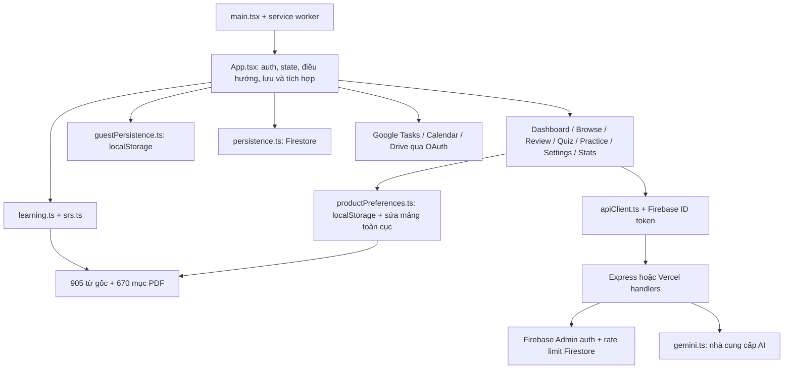

# Rà soát hệ thống ENG_MASTER

Ngày kiểm tra: 13/10/2026. Phạm vi: code hiện có trong workspace và bản build local.
Đây là snapshot trước implementation. Các lỗi thuộc đợt 1 đã được xử lý; xem [kết quả đợt 1](PHASE1_VERIFICATION.md).
Mục tiêu: chuẩn bị nâng cấp độ ổn định, trải nghiệm và tính năng học/AI, theo yêu cầu của chủ dự án.

## 1. Kết luận

Ứng dụng đã có phần lớn luồng của một sản phẩm học từ vựng: khách, đăng nhập Google, thư viện, flashcard, quiz, luyện tập chọn lọc, thống kê, sao lưu và AI. Danh mục đóng gói gồm 1.575 mục; đây là mốc dữ liệu cần bảo toàn khi nâng cấp.

Nền tảng phù hợp để phát triển tiếp bằng React + TypeScript + Firebase. Các vấn đề cần xử lý trước nằm ở tính toàn vẹn của dữ liệu người học, vòng đời phiên học, đồng bộ và kiểm tra tích hợp. Không cần đổi framework để giải quyết các vấn đề đã tìm thấy.

31 test hiện tại đều đạt, nhưng chưa bao phủ các luồng Cloud và tương tác quan trọng. Hai lỗi đã được tái hiện bằng chạy mã local: lịch sử flashcard chứa `undefined` bị Firebase SDK từ chối; backup có tiến độ từ cá nhân không thể nhập lại qua bộ kiểm tra hiện tại.

Kế hoạch thực hiện: [PROJECT_PLAN.md](../PROJECT_PLAN.md).

## 2. Bản đồ kiến trúc hiện tại



| Thành phần | Hiện trạng | Hàm ý khi nâng cấp |
|---|---|---|
| `src/App.tsx` | 1.079 dòng, giữ trạng thái, auth, Cloud, Google APIs và điều hướng bằng `currentView` | Tách theo trách nhiệm và giữ hành vi trước khi thiết kế lại |
| `src/components/` | 7 màn hình nghiệp vụ, dùng lazy import; flashcard Review/Practice có nhiều logic tương tự | Dùng chung engine phiên học và thành phần thẻ |
| `src/lib/learning.ts`, `srs.ts` | Trạng thái học và hàng đợi chung; SM-2 thuần nhưng lấy thời gian thực trong hàm | Có nền để kiểm thử và chuẩn hóa chính sách học |
| Khách | Profile, progress, hoạt động lưu bằng các khóa localStorage | Chưa có schema runtime, migration và cơ chế lưu nguyên tử |
| Cloud | Profile + progress từng từ + dailyActivity; đọc bằng `getDoc/getDocs` | Chưa có subscription, merge hoặc hàng đợi thao tác bền vững của ứng dụng |
| Từ cá nhân/yêu thích | Lưu toàn trình duyệt; thêm/xóa trực tiếp `VOCABULARY` | Chưa tách theo tài khoản, không đồng bộ đầy đủ |
| Sao lưu | Backup v2: profile + progress; hỗ trợ JSON/CSV | Chưa chứa custom words, favorites, dailyActivity và settings |
| AI | 4 endpoint, yêu cầu token, có rate limit và giới hạn body 64 KB | Đã có lớp bảo vệ cơ bản; thiếu schema đầu ra và kiểm tra nghiệp vụ |
| PWA | Worker tự viết, precache `/` + manifest, runtime cache các GET cùng origin | Chưa bảo đảm màn hình chưa từng mở chạy offline |
| Dữ liệu từ vựng | Có nguồn PDF, bộ review cố định, script tái tạo và quality gate | Giữ nguyên ID/nội dung đã chốt; bổ sung metadata học riêng |
| Triển khai | Express local/Node; endpoint Vercel riêng; Firebase config chỉ rules/emulator | Cần thống nhất hợp đồng triển khai và kiểm tra môi trường thật |

## 3. Phát hiện ưu tiên

P0: có thể mất dữ liệu hoặc không lưu được luồng đang có. P1: sai hành vi hoặc thiếu nền tảng cần thiết. P2: chất lượng, hiệu năng và mở rộng.
“Đã tái hiện” là có chạy mã xác nhận; “đọc mã” là kết luận trực tiếp từ implementation; “cần kiểm tra môi trường” là chưa xác nhận bằng dịch vụ thật.

| ID | Mức | Bằng chứng | Vấn đề và ảnh hưởng |
|---|---|---|---|
| F01 | P0 | **Đã tái hiện**; `App.tsx:608`, `persistence.ts:183`, `firebase.ts:26` | `newLog` luôn có `correctCount/totalQuestions`, nhưng flashcard/practice không truyền hai giá trị. Firestore mặc định từ chối `undefined` trong `history`. Tiến độ từng từ có thể lưu, nhưng history/streak/dailyActivity của phiên bị lỗi. |
| F02 | P0 | **Đã tái hiện**; `backup.ts:10`, `:162`, `:180`; `productPreferences.ts:23` | Tập ID của backup được chụp lúc import module, trước khi custom words được hydrate/thêm. Backup có progress custom word bị báo `Unknown vocabulary id`. File cũng không chứa định nghĩa từ cá nhân để phục hồi trên máy khác. |
| F03 | P0 | Đọc mã; `SettingsView.tsx:192`, `:214` | CSV đi thẳng vào `onImportBackup`, bỏ qua `normalizeBackup`; chấp nhận dữ liệu số/ngày chưa được kiểm tra, bỏ qua ID không biết. Không có bước xác nhận thay thế giống JSON; CSV không hợp lệ có thể tạo progress rỗng và thay thế dữ liệu cũ. |
| F04 | P0 | Đọc mã; `persistence.ts:86` | Restore Cloud xóa progress và dailyActivity trước, rồi ghi nhiều batch và profile. Thất bại giữa các bước có thể để dữ liệu bị xóa hoặc phục hồi một phần. Chia batch 400 thao tác giúp giới hạn batch, nhưng không tạo tính nguyên tử cho cả restore. |
| F05 | P1 | Đọc mã; `App.tsx:527`, `persistence.ts:57` | State tiến độ được cập nhật trước, progress/profile ghi song song và độc lập. Lỗi một nhánh không rollback hay giữ thao tác bền vững; badge Cloud chỉ dựa vào `navigator.onLine`, không chứng minh đã đồng bộ. Ghi đồng thời từ nhiều thiết bị có thể ghi đè tiến độ/tổng đếm. |
| F06 | P1 | Đọc mã; `App.tsx:222`, `:259`, `firebase.ts:26` | Dữ liệu Cloud chỉ đọc lúc fetch, không theo dõi thay đổi thiết bị khác. Persistent cache chưa cấu hình; lỗi offline lúc tải chuyển sang một profile khách khác, chưa có luồng merge Khách → Google. Cần kiểm thử offline của tài khoản đã đăng nhập. |
| F07 | P1 | Đọc mã; `ReviewSession.tsx:80`, `:114`, `PracticeSession.tsx:117`, `:146` | Không có khóa thao tác khi chấm thẻ/lưu/chuyển thẻ. Review vẫn đi tiếp sau lỗi lưu; Practice không `await` callback async. Nhấn liên tiếp và lỗi mạng có thể khiến ghi/chuyển thẻ lặp; cần kiểm tra E2E và cơ chế operation ID. |
| F08 | P1 | Đọc mã; `PracticeSession.tsx:126`, `App.tsx:869` | Practice tự điều chỉnh quality theo mode; quiz chỉ cập nhật lỗi/ngày, không cập nhật interval/repetitions/easiness. Đây là chính sách khác nhau chưa được mô tả rõ; cùng một từ có ý nghĩa tiến độ khác nhau giữa các chế độ. |
| F09 | P1 | Đọc mã; `Dashboard.tsx:87`, `:278` | Kế hoạch ngày đưa mọi từ vào sort; từ mới có timestamp 0 nên có thể đứng trước từ đến hạn. Từ đã có progress luôn có thể được gắn “Đến hạn”, kể cả ngày ôn còn ở tương lai. Kế hoạch hiển thị không phải hàng đợi mà nút ôn tập thực sự dùng. |
| F10 | P1 | Đọc mã; `StatsView.tsx:79`, `:272`, `:462` | Đường EF theo thời gian lấy trạng thái mới nhất của từng từ rồi tính trung bình chạy; không phải lịch sử EF thật. Nhãn ngưỡng ghi ≥5 nhưng logic dùng ≥3; trục EF cố định 2.0–3.2 không phù hợp toàn miền giá trị. |
| F11 | P1 | Đọc mã; `persistence.ts:183`, `guestPersistence.ts:96`, `types.ts:1` | History chỉ giữ 50 phiên trong profile, không có sự kiện trả lời/thời lượng; practice được ghi chung loại `review`. Không đủ dữ liệu để dựng lại đường học, thống kê dài hạn, phiên dở hoặc đối chiếu xung đột. `studyTimeMinutes` chưa có luồng tăng thời gian học. |
| F12 | P1 | Đọc mã; `productPreferences.ts:3`, `:38`, `:48`; `Browse.tsx:321` | Custom words/favorites dùng khóa chung cho các tài khoản trên một trình duyệt; mảng từ vựng bị thay đổi toàn cục. Xóa từ không xử lý progress/favorites còn tham chiếu ID đã xóa. Cần owner scope và kho từ bất biến có version. |
| F13 | P1 | Đọc mã; `gemini.ts:153`, `:175`, `:197`; `QuizSession.tsx:139`, `:148` | API gửi headword/meaning mà không gửi ID ổn định, prompt yêu cầu `wordId` nhưng không cung cấp mapping. Client tìm câu bằng `options.includes(headword)` có thể nhầm một distractor thành từ mục tiêu. Server mới kiểm tra JSON là array, chưa kiểm tra type, đáp án, options hay coverage. |
| F14 | P1 | Đọc mã; `public/sw.js:1`, `:2`, `:22`, `:25` | Các chunk lazy không được precache toàn bộ; khi offline, request JS/CSS thiếu cache được fallback bằng HTML `/`. Cache giữ tên cố định qua các release, cache cả response lỗi và activate xóa cache khác cùng origin. Chưa có quy trình cập nhật an toàn cho phiên đang học. |
| F15 | P1 | Đọc mã; `firestore.rules:64`, `:87`; `firebase-blueprint.json` | Rules progress thiếu giới hạn không âm/range/date có nghĩa; history mới kiểm tra list/độ dài. Blueprint còn `maxItems: 905`, `lastStudyDate` là date-time và `status` progress, khác implementation hiện tại. Không có test rules/emulator trong bộ test. |
| F16 | P2 | Đọc mã; `App.tsx:130`, `:328`, `:346` | Login xin Tasks/Calendar/Drive cùng lúc; mỗi `googleFetch` lại popup reauthenticate. Một lần đồng bộ 5 từ có thể yêu cầu nhiều popup. Chưa có incremental scopes, token dùng lại trong một tác vụ hay chống tạo task/event trùng. |
| F17 | P2 | Đọc mã; `apiClient.ts:20`, `apiSecurity.ts:61`, `gemini.ts:71` | AI thiếu timeout/cancel ở ứng dụng, schema dùng chung và cache kết quả. Rate limit theo cửa sổ có resetAt nhưng chưa có TTL Date/Timestamp/cleanup trong repo; giới hạn phút không thay ngân sách tổng. Model fallback thử tiếp mọi lỗi, chưa có phân loại retry. |
| F18 | P2 | Đọc mã; `SettingsView.tsx:35`, `:83`; `App.tsx:972` | Timer thông báo chỉ khởi tạo khi mở Settings và không phải lịch chạy khi đóng trình duyệt. Profile/goal/avatar báo thành công trước khi callback lưu xong. Avatar base64 đặt trong profile, làm tăng kích thước document. |
| F19 | P2 | Đo build; `dist/index.html`, `vite.config.ts` | HTML và dependency graph main import/preload cả chunk charts. Tổng 8 tài nguyên JS/CSS được HTML tham chiếu: **509.055 byte gzip**; charts riêng **113.504 byte**. Lazy Stats chưa loại charts khỏi tải đầu. Đây là số build, không phải kết quả đo mạng/LCP trên điện thoại. |
| F20 | P2 | Đọc mã; `tsconfig.json`, `package.json`, `components/*` | Chưa bật strict; lệnh `lint` chỉ chạy TypeScript + vocabulary gate. Có nhiều import/type/helper nhắc học được sao chép nhưng không dùng ở các màn hình. Chưa có router URL/back, Error Boundary, E2E được đưa vào scripts/CI hay workflow CI trong repo. |

## 4. Chi tiết hai lỗi đã chạy xác nhận

### F01 — History chứa undefined

Chạy `setDoc` bằng Firebase Web SDK đã cài, với document demo và history giống cấu trúc flashcard. SDK từ chối ngay khi serialize, trước khi cần kết nối Cloud:

```text
invalid-argument
Function setDoc() called with invalid data. Unsupported field value: undefined
```

`App.logSessionHistory` tạo object có các trường tùy chọn mang giá trị `undefined`; `recordCloudSession` đưa object đó vào `history` và ghi bằng transaction. Cấu hình hiện tại dùng `getFirestore(app)` mặc định. Cách sửa ưu tiên: tạo log chỉ chứa các trường có giá trị, kiểm tra schema trước khi ghi; không dùng bật bỏ qua undefined để che mọi lỗi đầu vào. Quy tắc SDK đã đối chiếu với [FirestoreSettings](https://firebase.google.com/docs/reference/js/firestore.firestoresettings).

### F02 — Backup custom word không round-trip

Trong bộ nhớ tạm, import module backup, thêm một custom word, tạo progress hợp lệ cho từ đó rồi chạy `normalizeBackup(createBackup(...))`:

```text
Unknown vocabulary id: custom-<uuid>
backupFields: version, exportedAt, profile, progress
```

Không thay đổi dữ liệu người dùng thật. Việc sửa tập ID động mới chỉ giải quyết một phần; định nghĩa từ cá nhân vẫn cần nằm trong backup, cùng chính sách ID/catalog version và migration.

## 5. Kiểm tra thực tế và giới hạn

| Kiểm tra chạy trong lượt rà soát | Kết quả |
|---|---|
| `npm run typecheck` | Đạt |
| `npm test` | 31 test / 8 file đạt |
| `npm run validate:vocab` | 1.575 mục đạt, không có cảnh báo |
| `npm run build` | Đạt; không chunk nào vượt ngưỡng cảnh báo 500 kB |
| Serialization history qua SDK | Tái hiện lỗi F01 |
| Custom word + backup round-trip | Tái hiện lỗi F02 |
| Đọc dependency graph bản build | Main import charts; 509.055 byte gzip tài nguyên tham chiếu trong HTML |

Chạy bằng Node **26.5.0** trên máy local; cấu hình release yêu cầu **22.x**. Cần chạy lại gates trên Node 22 trong CI để xác nhận môi trường release.

Không chạy Firebase Emulator, tài khoản Google thật, Firestore production, Gemini có khóa thật, publish/deploy hoặc audit dependency online trong lượt này. Chưa có đo Core Web Vitals, stress nhiều thiết bị hay kiểm thử production service worker. Các vấn đề concurrency/offline đã ghi là phát hiện qua mã, không được trình bày như lỗi đã chạy trên production.

Test hiện có tập trung vào vocabulary, backup, learning helpers, local guest persistence, preferences, chunking và HTTP/client API. HTTP auth/rate-limit tests dùng dependency giả; chưa chứng minh policy transaction của `apiSecurity.ts` hoặc quyền Firestore thật. Bộ vocabulary gate kiểm tra tính nhất quán với review đã chốt; không phải chứng nhận độc lập cho mọi nội dung ngôn ngữ.

## 6. Những phần nên giữ

- 1.575 ID của từ đóng gói, nguồn PDF và nội dung ngôn ngữ đã chốt.
- Phân biệt “từ mới” và “đến hạn ôn” trong `learning.ts`.
- SM-2 hiện tại làm baseline; sửa chính sách sử dụng và khả năng kiểm thử trước khi cân nhắc thuật toán khác.
- Guest mode, token Firebase cho AI, rate limit phía server và giới hạn body đã có.
- API dùng chung handler giữa Express/Vercel; UI có primitive Button/Card/Modal với một số hỗ trợ keyboard/focus.
- Review/import/validation pipeline và kiểm tra hồi quy ID để bảo toàn tiến độ.

## 7. Tài liệu kỹ thuật đã đối chiếu

- Firestore mặc định dùng memory cache; persistent cache cần cấu hình: [Firestore offline](https://firebase.google.com/docs/firestore/manage-data/enable-offline), [FirestoreSettings](https://firebase.google.com/docs/reference/js/firestore.firestoresettings).
- JSON/schema của model không thay thế kiểm tra giá trị và ý nghĩa đáp án ở ứng dụng: [Gemini structured outputs](https://ai.google.dev/gemini-api/docs/structured-output).
- Manifest precache nên được sinh từ build với revision/content hash: [Workbox precaching](https://developer.chrome.com/docs/workbox/modules/workbox-precaching).

Các nguồn này giải thích hành vi nền tảng và phương án dự kiến. Khả dụng model cụ thể, quota, cấu hình tài khoản và quyền OAuth thực tế phải được kiểm tra trên môi trường staging khi triển khai kế hoạch.
